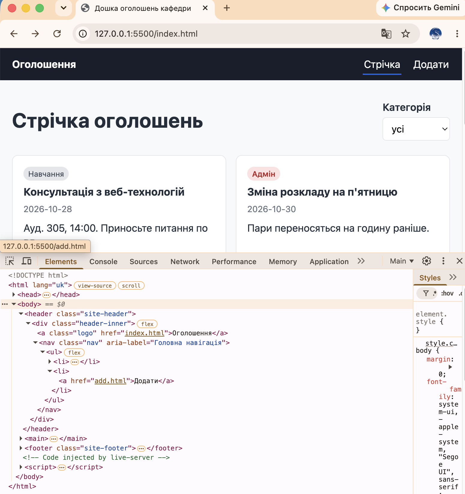
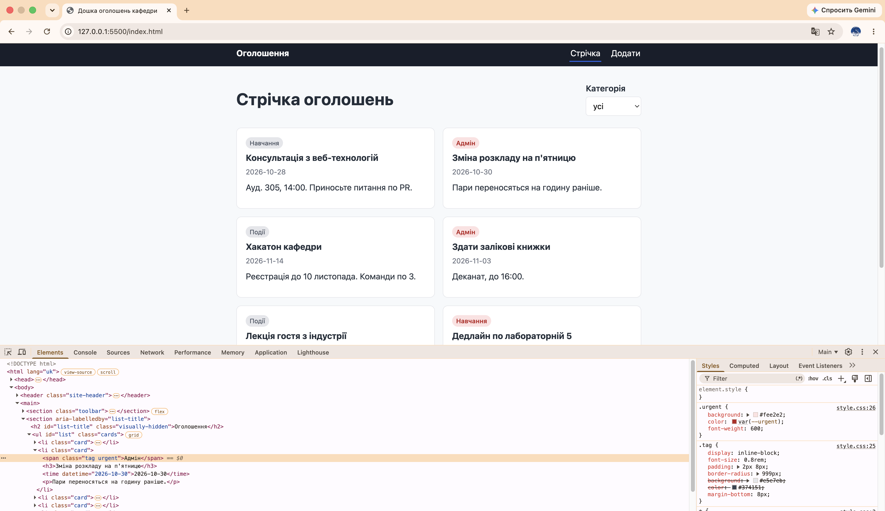
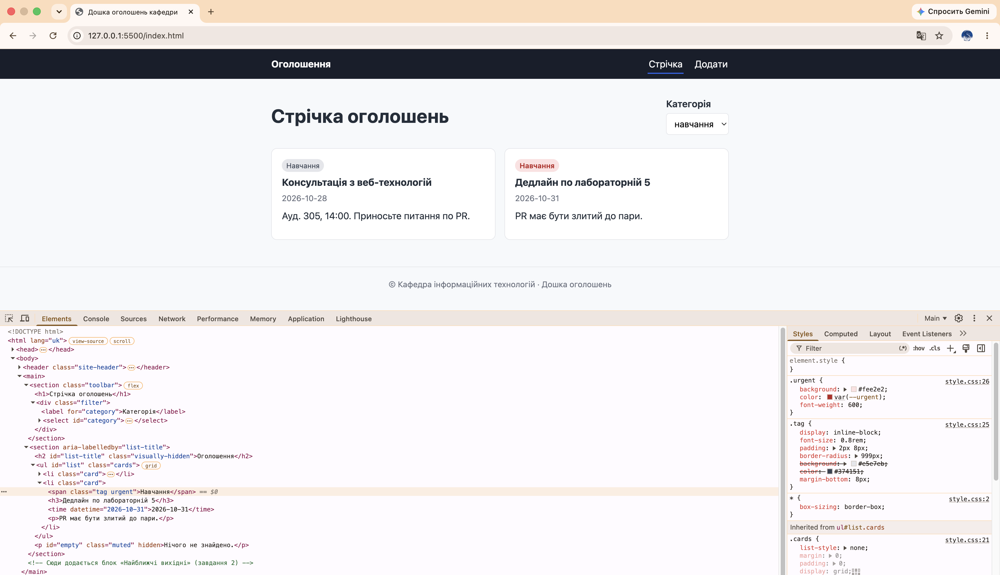

## Помилка у Тикеті №1 — «На сайті, відкритому за посиланням (Pages), кнопка „Додати“ у шапці веде на 404. У мене на ноутбуці все працює».

- **Шар:** HTTP, HTML.
- **Інструмент:** Elements → `.site-header` → `.header-inner` → `<nav>` → `<ul>` → `<li>` → <a href="Add.html">Додати</a>.
- **Винуватець:** `<li><a href="Add.html">Додати</a></li>`.
- **Причина:** атрибут href зі значенням `Add.html` направляє на сторінку `Add.html`, але у проєкті такої не існує, існує `add.html`.
- **Виправлення:** змінити рядок винуватця на `<li><a href="add.html">Додати</a></li>`.

- **Скріншот до 1 тикета з результатом виправлення**

---

## Помилка у Тикеті №2 — «Термінові оголошення мають бути з червоною позначкою категорії — а вони сірі, як усі».

- **Шар:** CSS.
- **Інструмент:** Elements → `<main>` → `<section>` → `.cards` → `.card` → `` у `.urgent` → Styles.
- **Винуватець:** `.tag .urgent { background: #fee2e2; color: var(--urgent); font-weight: 600; }`.
- **Причина:** у `.urgent` відсутні стилі, тому що стилі для `.urgent` у файлі `style.css` прописані, як для дитини (спадкоємця) `.tag`, але це не правильно, оскільки і `.tag` і `.urgent` мають однакову (рівноправну) приналежність до рядку з ``.
- **Виправлення:** у рядку винуватця видалити `.tag`.

- **Скріншот до 2 тикета з результатом виправлення**

---

## Помилка у Тикеті №3 — «Обираю категорію у фільтрі — показує „Нічого не знайдено“, хоча оголошення цієї категорії є. Працює тільки „усі“».

- **Шар:** JS.
- **Інструмент:** `app.js` → `applyFilter` → `filtered`.
- **Винуватець:** `const filtered = value === "all" ? announcements : announcements.filter((a) => a.category === value);`.
- **Причина:** у масиві обʼєктів `announcements` у кожному з елементів значення поля `category` записано з великої літери. Через це виникає конфлікт, бо у рядку винуватця порівнюються значення поля `category` елементів зі значенням `value`, яке містить обране користувачем значення назви категорії з HTML, але в HTML усі назви категорій написані повністю малими літерами, тож порівняння повертає `false`.
- **Виправлення:** змінити рядок винуватця на `const filtered = value === "all" ? announcements : announcements.filter((a) => a.category.toLowerCase() === value);`, щоб назви категорій були повністю маленькими додано `.toLowerCase()`.

- **Скріншот до 3 тикета з результатом виправлення**

---